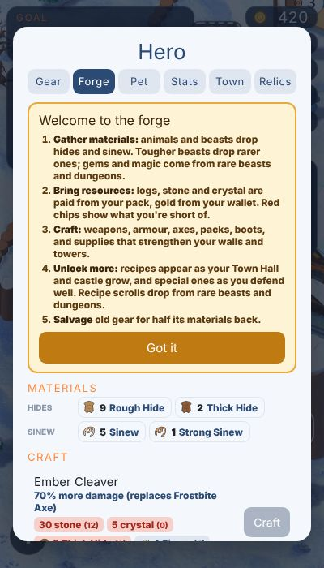
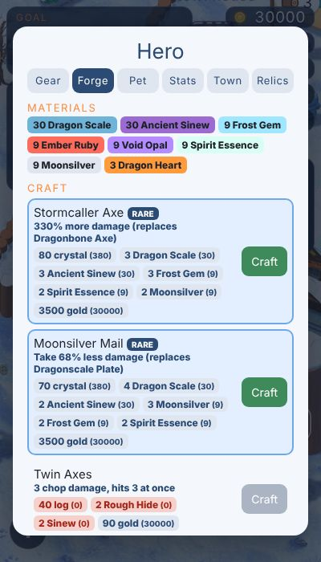

# Frosthold Outpost

An original survival and town-building game for phones and desktop browsers. Lead a frozen settlement: gather wood, food, stone and crystal, keep your people warm and fed, wall in the fort, and grow it from a camp into a castle while raiders strike each night and monsters roam the wilds.

Open `index.html` in a browser. There is no build step; three.js r128 loads from cdnjs. This file is also the in-game **Help** (cog menu), so keep it up to date with every change.

## Getting started

- **Move:** swipe (drag) anywhere on the screen for a floating joystick, or use WASD / arrow keys.
- **Gather:** your axe swings on its own at trees, rocks, animals and enemies in reach. What you gather stacks on your back.
- **Build and buy:** stand on a build space for a moment and it starts taking what you carry and your gold (the short pause stops you paying by accident when you walk across one).
- **Sell:** stand in the dashed spot behind a stall's counter to hand over logs (firewood stall) or food (cookhouse). Villagers buy them for gold.
- **The GOAL card** (top left) always says what to do next; the orange arrow on the ground points the way.
- A new game starts with a short **Tutorial**; **Skip tutorial** closes it, and **Tutorial** in the cog menu replays it.

## Survival

- **Warmth:** every villager burns firewood. Sell logs at the firewood stall to keep the warmth meter up. Each log gives 1 warmth at Town Hall I, 2 at II and 3 at III, and bigger towns buy faster. Blizzards (winter, from Town Hall II) burn firewood 2.5× faster.
- **Food:** once the cookhouse is built, villagers also eat. Sell meat, fish and veggies there; each food item lasts three times as long as a log.
- If either meter hits zero, villagers start dying. Lose them all and Frosthold falls.
- With both meters above half and free beds, new villagers arrive. They pay taxes to the Town Hall.
- **Housing:** each house holds 4; **Bunk Beds** (Town Hall II) raise that to 7 and **Stone Lofts** (Town Hall III) to 10; each Town Hall and Castle level adds more. Workers and guards live in their lodges and barracks, so they don't take beds.

## Food sources
All food counts as one resource, **food** (the bowl counter): meat you hunt, veggies you grow, fish and fruit and roots you forage all fill it and feed the town at the cookhouse.
- **Fullness:** not all food is equal. Each piece you bring to the cookhouse fills your people by a different amount:

  | Food | Fullness per piece |
  |---|---|
  | Meat (hunted animals, hunters, the meat pile) | 4 |
  | Fish (fishing, the fishery) | 3 |
  | Vegetables and wild roots (garden, foraging) | 2.5 |
  | Berries | 1.5 |

  So a pack of meat keeps the town fed far longer than the same number of berries. The food counter still counts pieces.
- **Foraging:** berry bushes (red berries, 2 food) and wild roots (orange tops, 3 food) grow all over the wilds; walk into one to pick it. Each also gives the plant as an ingredient (Snowberries, Wild Roots). They grow back after a few minutes.
- **Herbs** grow in the wilds too: **Frostmint** (pale green, everywhere), **Nightshade** (purple, 80 m and out), **Ember Root** (orange, 110 m and out) and **Moonpetal** (white, rare, 190 m and out). They're potion ingredients, not food.
- **Rabbits** (1 food) and **deer** (2–3 food) graze in large numbers around the settlement.
- **Yaks** (5–6 food) and **boars** (5–6 food, they charge back when hurt) keep to the far meadows, 130 m and more out. **Eagles** circle the far meadows too.
- **Garden** (after the cookhouse): veggies pile up beside it, fastest in summer.
- **Fishery** (Town Hall II) and **fishing** (see below).

## Fishing

Stand still at a lake's edge (or out on the ice in winter, where you cut a hole) and you cast automatically. After a few seconds you catch 2–4 fish, more at far lakes. Now and then you reel in a sunken treasure chest. Fishing stops if raiders are close.

## Getting around obstacles
Workers, villagers, guards, animals, pets, camp monsters and raiders all walk around trees, rocks, buildings and lakes instead of through them (flying creatures excepted).

## Days, nights and seasons
- A day lasts **6 minutes**; the last part is night: darker, colder and more dangerous.
- Every 2 days the season turns: winter, spring, summer, autumn. Outside winter the snow melts off trees, roofs, walls and rocks: trees turn green (or autumn orange) and roofs show their shingles. Summer needs the least firewood, winter the most. Lakes block your path except in winter, when they freeze.
- **Every day is harder:** raiders get more health and hit harder, raids get bigger, camp monsters are tougher, and firewood and food burn faster (up to double).
- At night, **workers drop off what they carry and go home** until morning.

## Raids and defense
- **One raid a night, at nightfall.** Raiders are a mix: wolves and goblins at first, then spiders, bears, trolls, yetis and wraiths. Raiders who can't break through give up after 3 minutes.
- Raiders chew through walls; broken sections show a cheaper rebuild space. They go after workers caught outside the walls first.
- **Watchtowers** shoot anything in range; every corner of every wall ring has a tower spot. Each tower has its own upgrades (Crossbows, Ballista, Frost Spire).
- **Blacksmith defense upgrades:** Arrows II/III (all towers), **tower range** (Spyglasses, High Perches, Eagle Eyes: +4 m each), **wall reinforcement** (Iron Bands, Stone Bastions, Rune Wards: +75% wall strength each) and Masonry.
- **Guards** (Barracks, Town Hall II) post at all four gates, north, south, east and west in turn, and fight raiders nearby.

## Building the town

| Tier | Goal | Unlocks |
|---|---|---|
| Camp (Town Hall I) | Rebuild the camp palisade | Cookhouse, garden, houses, watchtowers, blacksmith, logger lodge |
| Town (Town Hall II) | Wall in the town square | Barracks, hunter lodge, warehouse, quarry lodge, fishery, med center, more houses and towers |
| Citadel (Town Hall III) | Raise the citadel wall | Crystal mine, miner camp, crystal trader, treasury, carpenter, guard drill |

Finishing a new wall ring tears down the old one and clears the forest inside it. Town Hall upgrades need the current ring fully secured.

## Castle and the final battles

After Town Hall III and the citadel wall, the Town Hall space offers **Castle I, II and III**. Each level:
- turns the hall into a bigger stone keep, every wall into brick stone with battlements, towers into round stone towers, gates into stone gatehouses, and paves the keep with cobblestones;
- makes walls, towers and guards much stronger, adds housing, and allows two more **guard battalions** (Train Battalion raises three guards at once);
- also makes the nightly raids much bigger and tougher.

At **Castle III** the final battles begin: each night brings a **dragon siege** (one dragon, then two, then three, with a large escort). Defeat all three for **victory**; you can keep playing after.

## Workers
- **Loggers, hunters, stonecutters and miners** gather on their own and stack what they collect on a pile beside their lodge. Stand on a pile to load your pack. Piles hold 80, or 300 after the Warehouse.
- **Hunters** stay near the settlement and hunt rabbits and deer.
- **Gatherers** (hire them by the garden once it's built) pick berries, roots and herbs within about 130 m of town. Food goes to the cookhouse; the fruit and herbs go into the **town chest** for anyone to use.
- **Tap a pile's label** to lock it (a padlock shows): haulers won't take from a locked pile, so you can save it for building. Tap again to unlock.
- **Haulers** carry logs to the firewood stall and food to the cookhouse, serving whichever meter is lower first.
- **Menders** walk the walls and repair damaged sections.
- Each building shows how many of its workers you have (for example **Loggers 2/3**). A hire space disappears when you can't hire more; it returns when the next Town Hall or Castle level raises the limit.
- Workers have health; a worker who dies drops what they carried.

## Village upgrades
Three gold-only upgrade spaces sit around the plaza: comfort (supplies last longer), trade (more income) and folk (hero, workers and towers). Later upgrades wait for Town Hall II and III.

## Your hero

- **Hero levels** come from gathering, building, selling and fighting, and add damage and health.
- **Personal blacksmith upgrades:** the **Crystal Pick** (to mine crystal) and **ranged weapons** (below). Axes, packs, boots, weapons and armour are crafted at the forge (see Crafting). In co-op each player has their own.
- **The Hero screen** (cog → Hero): your 3D hero in their gear, equipment slots, your Gear and your Materials listed separately (tap an item to see it or equip it), plus Pet, Stats, Town and Relics tabs, and your name and coat colour.
- New gear is equipped automatically when it's better than what you have.

## Crafting

- **Materials:** animals and beasts drop **hides** and **sinew** in four tiers. Better tiers come from tougher creatures, and they drop less often, so farm and explore:
  - **Rough Hide, Sinew:** rabbits, deer, eagles, wolves, goblins, spiders (common).
  - **Thick Hide, Strong Sinew:** yaks, boars, bears, trolls (uncommon).
  - **Shaggy Pelt, Beast Sinew:** yetis, wraiths, golems, raptors, sabre tigers (rare).
  - **Dragon Scale, Ancient Sinew:** mammoths, T-rexes, dragons (very rare).
  - **Metal: Iron Ingot, Steel Bar, Runesteel** (and rarer metals). Make them in the smelter (see Smelt & Brew below). Golems and trolls drop iron and steel; harder dungeons and chests give steel and runesteel. Metal goes into most weapons and armour past the first (Iron Mail, Runic Plate and up), Axe III and IV, and Iron Wall Braces.
  - Camp legends drop three times as often and give extra. In co-op, materials from your kills go to you.
- **The forge:** once the blacksmith is built, tap **⚒ Forge** anywhere inside your town walls to open the forge window. The first time, a short guide explains how it works. Recipes are grouped into tabs: **Weapons, Armour, Tools** (axes, packs, boots), **Smelt & Brew**, **Special, Town** (supplies) and **Salvage**. A green number on a tab shows how many recipes there you can afford. Each recipe shows a picture of the item; tap **Details** under it to see what it costs (what you have is shown beside each cost).
- Forged gear is equipped on your hero straight away and listed under **Gear** on the Hero screen. The forge's **⚔ Hero gear** button jumps there.
- **Skip ahead:** every weapon, armour, axe, pack and boots your Town Hall and castle allow is listed, so you can forge the best one you can afford straight away. Items you already own or that are weaker than what you have are shrunk into an **Owned and weaker** list.
- **Forge new or upgrade:** for weapons and armour, **Forge** makes a new item and you keep your old one; **Upgrade** trades in your best one and knocks half of its cost off the new one. Axes, packs and boots always upgrade (half of your current one's cost comes off).
- You can own several weapons and armours: tap one under Hero → Gear to wear it. The one you wear has an **Equipped** tag. Logs, stone and crystal come from your pack; gold from your wallet.
- **New recipe alerts:** when a recipe becomes available (a Town Hall or castle upgrade, a special earned, a scroll found), a banner tells you and the Forge button shows **NEW** until you open it.
- **Recipes reveal as your town grows:** the forge only shows what your Town Hall allows. New recipes appear with each Town Hall upgrade, rare gear at **Castle I** and legendary gear at **Castle II**. The forge tells you when the next ones unlock.
- **What you can craft:**
  - **Weapons:** Frostbite Axe → Ember Cleaver → Runic Greataxe (Town Hall II) → Raptor Fang Axe → Dragonbone Axe (Town Hall III).
  - **Armour:** Fur Jerkin → Iron Mail → Runic Plate (Town Hall II) → Sabre Hide → Dragonscale Plate (Town Hall III).
  - **Axes:** Twin Axes, Axe III, Axe IV. **Packs:** 100, 200, 400. **Boots:** Fur Boots, Runner Boots, Windwalkers (+12% speed each).
- **Rare and legendary gear** need precious materials as well as Dragon Scale and Ancient Sinew; rare needs Castle I and legendary Castle II. Once you own the Dragonbone Axe and Dragonscale Plate, you can forge:
  - **Rare:** **Stormcaller Axe** (+330% damage) and **Moonsilver Mail** (68% less damage).
  - **Legendary:** **Wyrmking's Wrath** (+450% damage) and **Aegis of the Ancients** (75% less damage).
- **Precious materials** (rare, so explore and fight for them):
  - **Frost Gem:** golems and mammoths, star-3 dungeons and up, treasure in far camps.
  - **Spirit Essence:** wraiths; dungeons.
  - **Ember Ruby:** raptors and sabre tigers (rare), T-rexes; star-4 dungeons.
  - **Moonsilver:** star-3 and star-4 dungeons, treasure chests in tougher camps.
  - **Void Opal:** wild dragons, star-4 dungeons, treasure in the farthest camps.
  - **Dragon Heart:** very rare from wild dragons; one in four dragons that besiege your castle drops one.
  - Every cleared dungeon gives at least one Frost Gem or Spirit Essence.

- **Special items** are one of a kind and stay hidden until you earn them through your hero's growth, how long your world survives, and how well you defend your town (raids beaten with **no wall broken** count; the forge shows your tally). Each is crafted once and always active:
  - **Hunter's Mantle** (+10% speed): reach hero level 8.
  - **Warden's Crest** (+40 max health): beat 3 raids with no wall broken.
  - **Veteran's Edge** (+25% damage): survive to day 20.
  - **Bulwark Shield** (12% less damage on top of armour): beat 6 raids with no wall broken, with Town Hall III.
  - **Heart of Frosthold** (legendary: +60 health, +30% damage): repel a dragon siege.
  - A banner tells you when a well-defended raid reveals one.
- **Recipe scrolls** are rare drops that teach one-of-a-kind items (crafted once, always active). Camp legends drop them three times as often:
  - **Raptor Claw Gauntlets** (+20% damage): raptors and sabre tigers.
  - **Wraith Shroud** (take 8% less damage): wraiths.
  - **Mammoth Hide Pack** (carry 100 more): mammoths.
  - **Glacier Greaves** (+15% speed): any cleared dungeon (1 in 4).
  - **Ember Talisman** (legendary, +50 health): T-rexes and the deepest dungeons.
- **Town supplies** strengthen your settlement (in co-op only the host can craft them):
  - **Bracing Planks:** repair every wall to full at once.
  - **Iron Wall Braces I–III** (Town Hall II): +20% wall health each.
  - **Tower Runes I–III** (Town Hall II): +20% tower damage each.
  - **Warding Totem I–II** (Town Hall III): towers shoot 3 m farther each.
- **Smelt & Brew:** a forge tab with a **smelter** and a **pot**. The **smelter** takes stone, crystal, metal, alloys, gems and glass; the **pot** takes food, hides, sinew, forage (fruit, roots, herbs), magic materials and anything already brewed. Tap ingredients to put up to six in, then **Fire the smelter** or **Stir the pot**.
  - The right mix makes a new material. A wrong mix gives junk (Slag or Gunk, sell it for 2 gold each) or burns away, but **half of any metal, gem, magic, alloy or brewed material comes back**; only hides, sinew and resources are lost.
  - **Alloys:** smelting any metal together with a gem or magic material always fuses into an alloy named after the rarest one you added (Frost, Spirit, Moon, Ember, Void or Heartfire Alloy). Better metal and more of it give more alloy. Each alloy unlocks a Special item (rivets, a band, a guard, gauntlets, an amulet and the legendary Heartfire Core).
  - Recipes are secret until you discover them. Once you've made something, its recipe is saved under **Known recipes** with **Make 1** and **Make 5** buttons. Mixes you've already tried that didn't work are flagged so you don't waste ingredients twice.
  - Everyone knows how to smelt **Iron Ingots** (3 stone, 2 logs). Steel, Runesteel, other metals and brewed materials such as tallow, glue, leather, oils and draughts are yours to find. Some need a hotter forge (a higher Town Hall).
  - Brewed materials unlock more **Special** items, shown once you've discovered what they need.
  - A failed pot mix sometimes leaves a **Murky Brew**: drinking it might give you a short boost, or might hurt you and make you queasy.

## Potions and food
- The pot can brew **potions and meals**, each with its own colour and bottle or bowl. Like every recipe they're secret until you make them. There are healing tonics, hearty meals, drinks for speed, strength and toughness, a rare magic elixir, and a poison you coat your weapon with.
- To use one, open **Hero**, find it under **Materials**, tap it to read what it does, then tap again to drink it (or coat your weapon).
- Active effects show as coloured tags at the top of the screen with the seconds left.
- **Salvage:** break down gear you own but aren't wearing (weapons, armour, ranged weapons, helmets, capes) for half its gold and materials back; logs, stone and crystal come back as gold. Anything you're wearing shows **Equipped** and can't be salvaged until you wear something else.
- Materials are shown at the top of the forge, grouped into **Hides, Sinew, Metal, Alloys, Brewed, Gems, Magic and Junk**, each with its own icon (also used in recipe costs). The Hero screen lists your **Gear** and your **Materials** separately.

## Town chest
- A shared **chest** stands in the plaza in front of the Town Hall. Walk up to it and tap **📦 Chest**.
- **Store all** puts every log, stone, crystal or meat from your pack, or all of one material, into the chest; **Take all** takes it back (resources only as far as your pack has room).
- Everyone in a co-op town shares the chest, so it's an easy way to pool hides, gems and building supplies. It is saved with the town.

## Ranged weapons
A ranged weapon fires on its own at the nearest threat in range, alongside your axes. **Hunting Bow** (12 m), **Crossbow** (Town Hall II) and **Rifle** (Town Hall III) are forged at the blacksmith. Magic staffs come from treasure: the **Frost Staff** slows, the **Fire Staff** explodes, and the **Storm Staff** throws lightning that jumps to two more foes.

## Pets

- Only a hero with a **Beast Charm** can tame. Earn one by slaying a quest legend, reaching hero level 10, or (rarely) from a treasure chest.
- Weaken a rabbit, eagle, wolf, bear, raptor, sabre tiger, T-rex or ice dragon. When it's weak enough (a third of its health for raptors, a fifth for T-rexes and dragons), a **Tame** button appears (with your odds) and a **Fight on** button lets you finish it off instead.
- Stand still beside it for two seconds. While you tame it, nothing (your bow, pet, towers or teammates) can finish it off. A failed attempt lets it recover some health.
- Name your pet when you tame it, and rename it from the Hero screen.
- A pet keeps 70% of its wild health and damage and is 80% of its wild size. It follows you, fights threats and any beast or camp monster within about 12 m of you (even before they spot you), hunts nearby animals when it's quiet, heals between fights, and **levels up** (+15% damage and more health each level).
- The **Pet** tab in the Hero screen shows your pet in 3D with its level, experience, health, damage, speed, total kills, raiders defeated, animals hunted, damage dealt and the day you tamed it.
- You keep one pet at a time. A pet that falls is gone for good.

## The wilds

- The world is a huge circle about **1200 m** in every direction from the fort, walled in by snowy mountains with boulder foothills you can't cross. The inner valley (about 340 m out) is where the town grows; beyond it the **outer lands** stretch to the mountains with more woods, lakes, ruins, herds, forage and quarries. The minimap starts dark and reveals what you and teammates explore; drag it to move it anywhere on screen.
- **Monster camps** guard treasure chests (orange easy, red medium, purple dangerous, gold once cleared). Spiders, goblins and wolves near the fort; bears and trolls farther out; wraiths and golems at the edges. Goblins throw spears, trolls hurl rocks and wraiths cast chilling frost orbs: keep moving to dodge.
- **Beast lairs** past 250 m: raptors and sabre tigers, then mammoths, T-rexes and giant ice dragons past 300 m. They prowl and spot you from far away, but give the best loot.
- **Deadly camps** (☠ on the tag) fill the outer lands past 600 m: bigger packs, sometimes mixed beasts, each 40% tougher and harder-hitting. Everything keeps getting tougher the farther out you go.
- Past 300 m the land is rough: boulder fields, ice spires and deep snow that slows you.
- About 70 **unguarded chests** are scattered across the valley (gold diamonds on the minimap), and **ruins** each hide a cache you can search once.
- **Crystal veins** lie 255 m out and beyond, scattered through the outer lands, and need a Crystal Pick.

## Treasure
Chests mostly give **crafting materials** (hides, sinew and metal for the camp's tier, with a chance of gems, magic and, in the farthest lairs, a Dragon Heart). Finished weapons and armour are now rare finds (the forge makes them). Chests can also hold heart stones (+health), war runes (+damage), wind charms (+speed), storage charms (bigger piles), ember totems, yak totems, staffs, helmets, capes, med kits, the Beast Charm, gold and materials. Farther out means better loot.

## Quests
The Town Hall offers one quest at a time (the Quest card): hunt animals, collect resources, defeat a kind of monster, clear camps, or slay a named **legend** marked with a gold **!** on the minimap. Quests match your hero: at the start they stay close to home (rabbits, deer, logs, fish, wolves and goblins), and tougher monsters and the named legends only appear as your hero levels up (legends from hero level 5 or Town Hall II). Rewards grow with the quest: gold, XP and a reward chest.

## Dungeons

Cave entrances lie 200–315 m out, with more scattered through the outer lands (purple squares on the minimap). Eight **☠ Epic dungeons** sit right under the mountains at the very edge of the world: the longest, deadliest levels, but they always give a Dragon Heart, Void Opals, Ember Rubies, Moonsilver, Runesteel, top hides and sinew and 1500 gold, and often an **epic** weapon (Glacierfall) or armour (Aurora Aegis) that can't be forged anywhere.  Tap **Enter dungeon** to play a 2D side-scrolling level: run, jump over pits and ice spikes, stomp or axe slimes, skeletons and bats, and reach the chest at the end. Dungeons are drawn in a chunky pixel-block style, hero included. You can jump about four blocks high, enough to reach every ledge. You have **three hearts** (top left): every hit, spike or fall costs one, and losing all three sends you back to the entrance. Your gear and looks come with you. Controls: on-screen arrows, attack and jump buttons (or A/D, W/Space, J). Reach the chest for a treasure chest. A cleared dungeon refills after two days.

## Knockouts and revives
- You respawn at the Town Hall a few seconds after being knocked out; your pack spills where you fell, and your crafting materials drop in a **satchel** marked "Your materials". Walk over it to get them all back (only you can pick it up, and it stays until you do).
- The **Med Center** (Town Hall II) revives you where you fell, once every 5 minutes.
- **Med kits** (Med Center, or treasure): stand next to a downed teammate for two seconds to revive them.

## Screen and menu

- On a keyboard, **1–4** turn collecting on or off: 1 wood, 2 food, 3 stone, 4 crystal (the same order as the counters on screen).
- Tap a resource counter to **drop** it (all or 10) or **stop collecting** it. While collecting is off you leave that resource alone: no chopping trees (wood off), mining rocks (stone or crystal off) or hunting animals (food off, except a charging boar), and you can't load it from piles. Your pet won't hunt either while food is off.
- The **cog** (bottom left) holds Help, Tutorial, Co-op, Hero, Pause, Sound and New game, switches to hide the goal, quest, town gauges, resources or minimap, and a switch for each kind of sound.

## Co-op
- **Room code (no account):** on the GitHub Pages site, tap **Co-op → Host a game** for a 4-character code and QR; friends tap Co-op and enter the code or scan the QR.
- **On claude.ai:** tap Co-op on the shared page; the first player hosts.
- Each player has their own hero, pack, wallet, gear and pet. Joining a new co-op room starts you at **level 1** with basic gear; your progress in that room is kept on your device, so rejoining the same room brings it back. Your solo hero is untouched. Set your name and coat colour under Co-op or Hero; teammates appear with your name, colour ring and what you carry, and as a coloured star on the minimap.
- Stand next to a teammate and tap **Give** to hand over gold, resources, crafting materials (one or all of a kind) or spare gear.
- Pausing in co-op only covers your own screen: the shared world keeps running for everyone, and your hero can't be hurt while paused.
- You get alerts when a teammate is under attack or knocked out. A phone that drops out or sleeps rejoins on its own, behind a Reconnecting screen (with a Play solo instead button) rather than flashing back to a solo game. If the host refreshes the page, their room reopens with the same code and friends reconnect automatically within about 20 seconds, with their gear, pet, gold, pack and position just as they left them; **Leave co-op** closes the room for good.

## Saving
Progress saves automatically every few seconds and when you leave the page, in this browser only. **New game** (tap twice) starts over.

## Play stats
When you play on claude.ai, the game records a summary of each session to help balance it: your hero name, how long you played, how far your town got, raids, knockouts, kills, crafting and materials. It does not record anything else about you. The game's owner sees these in the **Play report** (cog menu), which shows how players are doing and suggests balance changes.

## Art
Models come from Meshy (`tools/meshy_assets.py`, cached so nothing is paid for twice) and the painted ground from OpenAI images (`tools/openai_texture.py`).
